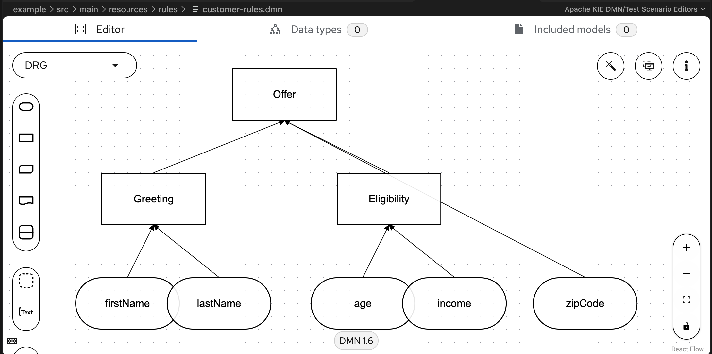
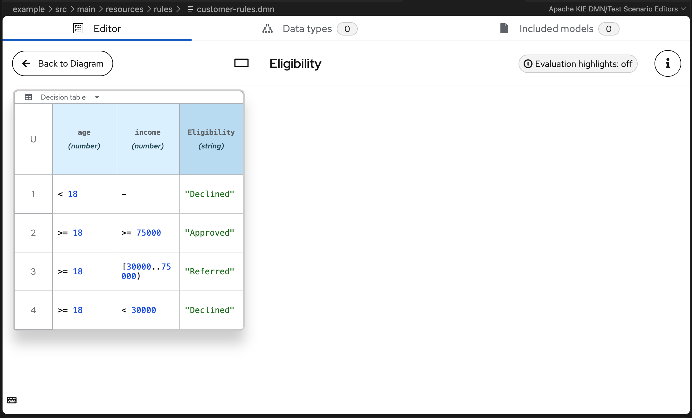

# spring-boot-business-rules

Opinionated repository to connect business rules written in a domain-specific language (DSL) to Spring Boot 4.0.9+.

Drop in the `spring-boot-business-rules` artifact and a
[Decision Model and Notation (DMN)](https://www.omg.org/spec/DMN) rules engine, from
[Apache KIE](https://kie.apache.org/) (Knowledge Is Everything; this project uses its Drools 10.x engine), is exposed
over a Representational State Transfer (REST) application programming interface (API) that exchanges JavaScript Object
Notation (JSON). No code required. See [What is KIE?](#what-is-kie) below.

> **Note:** this project was created quickly leveraging artificial intelligence (AI). It scratches an itch for people who
> want an opinionated way to bring [KIE](https://kie.apache.org/) and its DSL business rule language (DMN) into Spring
> Boot. Review it before relying on it, and contributions are welcome.

**Docs:** https://www.braintrustappliedresearch.com/spring-boot-business-rules/ ·
[API reference (Swagger UI, the user interface, or UI)](https://www.braintrustappliedresearch.com/spring-boot-business-rules/api/) ·
[Javadoc](https://www.braintrustappliedresearch.com/spring-boot-business-rules/javadoc/)

## Table of contents

- [What is KIE?](#what-is-kie)
- [Rules as decision tables](#rules-as-decision-tables)
- [Layout](#layout)
- [Using the artifact](#using-the-artifact)
- [Securing the endpoint](#securing-the-endpoint)
- [Dependency versions](#dependency-versions)
- [API](#api)
  - [Evaluating every decision at once](#evaluating-every-decision-at-once)
- [Running the example API](#running-the-example-api)
- [Adding a rule and testing it](#adding-a-rule-and-testing-it)
  - [1. Create the model](#1-create-the-model)
  - [2. Try it by hand](#2-try-it-by-hand)
  - [3. Add an automated test](#3-add-an-automated-test)
- [Code quality checks](#code-quality-checks)
- [Pipeline](#pipeline)
  - [Secrets and one-time setup](#secrets-and-one-time-setup)
- [FAQ](#faq)
- [License](#license)

## What is KIE?

[Apache KIE](https://kie.apache.org/) (Knowledge Is Everything) is an open source Apache Software Foundation project
that groups tools for automating business logic outside of application code. The part this repository uses is
[**Drools**](https://drools.org/), a long-established open source business rules engine written in Java. Drools
evaluates rules against the data you give it and returns the outcome. It supports its own rule language (DRL, the Drools
Rule Language) and runs DMN models, an industry-standard notation for decisions, through its DMN runtime, which is the
part this project exposes. Drools started as a standalone project, later joined the Red Hat-sponsored KIE family, and
is now developed under Apache KIE. KIE also covers workflow automation ([jBPM](https://www.jbpm.org/)) and has editors
for authoring the models.

**The business proposition** is to separate *what the business decides* from *the program that runs it*:

- **Rules live as data, not code.** A pricing, eligibility or routing policy is a model (a decision table or a short
  expression) that the people who own the policy can read and review, instead of conditionals scattered through Java.
- **One standard format.** DMN is an open specification from the Object Management Group (OMG), so models are not locked to one
  vendor's editor or engine, and any DMN-compliant tool can open them.
- **Change policy without rewriting logic.** A rule change is an edit to a row in a table. It still goes through review
  and testing, but it does not require restructuring control flow.
- **Auditable decisions.** Every decision has a defined inputs-to-outputs shape, so you can say exactly which inputs
  produced a result.

This repository does not change what KIE is; it is the glue that makes it quick to use from Spring Boot.

## Rules as decision tables

Business rules here are DMN models: a diagram of how decisions depend on each other,
where each decision is a small expression or a decision table you read like a spreadsheet. This is the example app's
ruleset, `customer-rules.dmn`, in the KIE DMN editor for VS Code:



Ovals are the inputs you send in the request and rectangles are decisions. `Offer` needs `Greeting`, `Eligibility` and
`zipCode`, so asking for `Offer` evaluates the decisions it depends on too (or send `"evaluate":"all"` to get every
decision at once, when instructions are enabled as in the example). `Greeting` and `Offer` are short expressions, and `Eligibility` is a decision table. Here is that
table:



A table like this is easier to look at, and to review, than the same logic written as nested `if`/`else` or `switch`
statements:

- **Each row is one rule and each column is one input**, so the whole policy fits on one screen.
- **Boundaries are visible at a glance** (age 18, income 30,000 and 75,000) instead of being buried inside conditions.
- **Rows do not depend on each other.** The `U` (unique) hit policy means exactly one row matches any input, and the
  editor flags rules that overlap. In code you have to trace the order of the branches by hand, because every
  `else` quietly assumes the lines above it did not match.
- **People who are not developers can read it**: analysts, compliance, and product owners can review and change a
  table without reading Java, and a rule change is an edit to a row, not to control flow.

For comparison, this is the same logic as code:

```java
if (age < 18) return "Declined";
if (income >= 75000) return "Approved";
if (income >= 30000) return "Referred";
return "Declined";
```

It looks short only because there are four rules and the statement order is doing hidden work. A real policy with
ten inputs and a hundred rules stays readable as a table, and rarely does as nested conditionals. The model is in
`example/src/main/resources/rules/customer-rules.dmn`; see "Adding a rule and testing it" below to write your own.

## Layout

| Module | Purpose |
| --- | --- |
| `spring-boot-business-rules/` | Auto-configured library: DMN engine + REST endpoint |
| `example/` | Spring Boot 4.0.9 app with a `CustomerRules` DMN model |

## Using the artifact

```xml
<dependency>
  <groupId>com.braintrustappliedresearch</groupId>
  <artifactId>spring-boot-business-rules</artifactId>
  <version>0.1.0</version>
</dependency>
```

Put `.dmn` files under `src/main/resources/rules/`. Configuration:

| Property | Default | Meaning |
| --- | --- | --- |
| `spring-boot-business-rules.path` | `/rules` | Endpoint path, **appended to** `server.servlet.context-path` (and any `spring.mvc.servlet.path`) |
| `spring-boot-business-rules.rules-location` | `classpath*:rules/**/*.dmn` | Where to find DMN models |
| `spring-boot-business-rules.enabled` | `true` | Turn the endpoint off |
| `spring-boot-business-rules.instructions-enabled` | `false` | Let callers learn about the rules: serves `GET <path>` (usage help plus the loaded models, inputs and decisions), enables `"evaluate":"all"`, and returns detailed responses. **Off by default; opt in to use it** |
| `spring-boot-business-rules.limits.max-inputs` | `500` | Most inputs one request may carry. A request over a limit gets `400` |
| `spring-boot-business-rules.limits.max-name-length` | `256` | Longest `evaluate` or `model` value, input name, or name inside an input value (characters) |
| `spring-boot-business-rules.limits.max-value-length` | `10000` | Longest single text value anywhere in the inputs, including inside lists and objects (characters) |
| `spring-boot-business-rules.limits.max-body-bytes` | `1048576` | Largest request body (bytes). A larger one gets `413` and is read only up to this size, never held whole. Keep a body-size limit in front of the application as well |

With `server.servlet.context-path=/api` and `spring-boot-business-rules.path=/business/rules`, the endpoint is `/api/business/rules`.

## Securing the endpoint

**The endpoint has no authentication of its own.** Anyone who can reach your application can call `POST <path>`, and by
trying inputs can work out your rules' thresholds. Protect it in the host application, like any API.

- **No Spring Security on the classpath:** the endpoint is open, and the library logs a startup warning
  (`UNAUTHENTICATED`) so this is not a surprise. If a gateway authenticates every request for you, silence it with
  `logging.level.com.braintrustappliedresearch.businessrules.UnprotectedEndpointWarning=ERROR`.
- **With `spring-boot-starter-security`:** Spring Boot blocks anonymous requests by default (they get `401`), but its
  default setup gives API clients no way to log in, so define a `SecurityFilterChain`. This minimal example uses
  Hypertext Transfer Protocol (HTTP) Basic authentication and was tested; use your real scheme (Open Authorization
  (OAuth) 2.0, JSON Web Tokens (JWT), and so on) in production. It turns off Cross-Site Request Forgery (CSRF)
  protection because this is a stateless API (configured via `sessionCreationPolicy(SessionCreationPolicy.STATELESS)`) with no browser session:

  ```java
  import org.springframework.context.annotation.Bean;
  import org.springframework.context.annotation.Configuration;
  import org.springframework.security.config.Customizer;
  import org.springframework.security.config.annotation.web.builders.HttpSecurity;
  import org.springframework.security.config.http.SessionCreationPolicy;
  import org.springframework.security.web.SecurityFilterChain;

  @Configuration
  class RulesSecurityConfig {

      @Bean
      SecurityFilterChain rulesSecurity(HttpSecurity http) throws Exception {
          return http
                  .authorizeHttpRequests(a -> a.anyRequest().authenticated())
                  .httpBasic(Customizer.withDefaults())
                  .sessionManagement(s -> s.sessionCreationPolicy(SessionCreationPolicy.STATELESS))   // no session cookie
                  .csrf(csrf -> csrf.disable())   // safe only because there is no session: no browser session, so no CSRF token
                  .build();
      }
  }
  ```

- **Request limits:** the library caps the number of inputs and the length of names and text values (the
  `spring-boot-business-rules.limits.*` properties, with safe defaults) and answers `400` beyond them, without repeating
  the offending text. It does **not** cap the request body as a whole, because Spring reads the body before the
  controller runs, so also set a body-size limit at your gateway or server.
- **Response headers:** every response from the endpoint, errors included, carries `X-Content-Type-Options: nosniff`
  and `Cache-Control: no-store` (a rule result describes one request and must not be cached). A header your
  application or Spring Security already sets is left alone.
- **Also put in front of it:** rate limiting, and keep `spring-boot-business-rules.instructions-enabled` off outside
  development.
- **Turn it off** entirely with `spring-boot-business-rules.enabled=false`.

## Dependency versions

This project's own `pom.xml` raises a few versions that Spring Boot manages, to pick up security fixes sooner. **Those
overrides do not reach your application.** You get the versions your own Spring Boot manages, so check them. With Spring
Boot 4.0.9 (the version this project builds on) they are older than the fixed ones:

| Library | Spring Boot 4.0.9 manages | Fixed in | What the fix is for |
| --- | --- | --- | --- |
| Jackson 2 (`jackson-2-bom.version`) | 2.21.7 | 2.21.8 | a critical deserialization flaw (Common Vulnerabilities and Exposures (CVE) ID CVE-2026-110879) |
| Jackson 3 (`jackson-bom.version`) | 3.1.7 | 3.1.8 | the same flaw |
| Logback (`logback.version`) | 1.5.38 | 1.6.5 | two path-traversal flaws (CVE-2026-19880 and CVE-2026-104721) |

This library does not use Jackson's polymorphic typing, so the Jackson flaw cannot be reached through it, but your
application may use Jackson elsewhere. The Logback flaws only matter if you use a `SiftingAppender` that discriminates on
a Mapped Diagnostic Context (MDC) value, and Logback 1.6 is a minor version past the line Spring Boot supports (this project's tests and startup
pass with it). Check whether your Spring Boot version already manages fixed versions before overriding anything.

To override them, if your project inherits `spring-boot-starter-parent`:

```xml
<properties>
  <jackson-2-bom.version>2.21.8</jackson-2-bom.version>
  <jackson-bom.version>3.1.8</jackson-bom.version>
</properties>
```

With Gradle and the Spring Boot plugin, set `ext['jackson-2-bom.version']` and `ext['jackson-bom.version']` (the
plugin's documented way to override managed versions; not tested here). If you import `spring-boot-dependencies` as a
bill of materials (BOM) instead of inheriting the parent, these properties have no effect and you must manage the versions yourself.

## API

- `GET <path>` returns usage instructions, the effective `spring-boot-business-rules.*` settings, and the loaded
  models with their inputs and decisions. **It is disabled by default** because it reveals the shape of your rules
  and where they are loaded from. Set `spring-boot-business-rules.instructions-enabled=true` to
  turn it on. When it is off the responses to `POST` are **quiet** too, so a caller cannot map your rules through
  ordinary requests: a `GET` gets `405 Method Not Allowed` (only `POST` exists); a response names only the decision that
  was asked for (no other decisions, no model name); DMN's messages, which name inputs, decisions and DMN identifiers, are
  replaced by one generic message (the details still reach your server logs); `"evaluate":"all"` is an unknown decision
  (`404`); and error bodies do not list the models.
- `POST <path>` takes a JSON body: every key except `evaluate` (and optional `model`) must be a declared DMN input of
  the model; `evaluate` names the decision to run. Dependent decisions are evaluated too. Any other key, including the
  name of a decision, is rejected with `400`: a value supplied under a decision's name would otherwise replace that
  decision's result and let a caller bypass the rule. The body must be one **UTF-8** (8-bit Unicode Transformation Format) JSON object with **no duplicate keys**, at
  any depth: with the usual "last one wins" a gateway that checked the first `"age"` and this endpoint that used the last
  would disagree about the request, and the same goes for a body in UTF-16 or UTF-32, which parsers can sniff but a
  gateway reading UTF-8 cannot see into. So a duplicate or a non-UTF-8 body (like an empty or malformed one) gets `400`.
  Use `"evaluate":"all"` to run every decision in a model in one call (see below).
  Responses: `200` result, `400` an empty, non-UTF-8, malformed or duplicate-key body, missing `evaluate`, an unknown
  input, an ambiguous `all`, or a request over a limit (`model` must be a string), `404` unknown decision, `413` a
  body over `limits.max-body-bytes`, `422` nothing was decided (see below).

**A `null` result is never a success.** A request that is well formed but cannot be decided gets `422`, not `200`: a
required input is missing, an input has the wrong type or is `null` (DMN only warns "no rule matched ... setting result to
null", and for an expression like `firstName + " " + lastName` with a number it says nothing at all), or a decision
produced no result. A warning from a decision your decision depends on counts too, so a request cannot look successful
while a rule it relied on never matched. The body still carries whatever was computed, so a client can inspect it. Model
your decisions so that a legitimate outcome is never `null` (give a decision table a catch-all rule or a default output);
a decision that deliberately returns `null` is reported as `422`.

### Evaluating every decision at once

Instead of calling `Greeting`, `Eligibility` and `Offer` one by one, send the reserved value `"evaluate":"all"`. It runs
every decision in the model and returns them all. **It needs `spring-boot-business-rules.instructions-enabled=true`**
(the example app sets it), because it exists to list the model's decisions; with instructions off it is an unknown
decision and returns `404`:

```sh
curl -X POST localhost:8080/api/business/rules -H 'Content-Type: application/json' \
  -d '{"firstName":"Ada","lastName":"Lovelace","age":36,"income":120000,"zipCode":"94105","evaluate":"all"}'
```

```json
{
  "evaluate": "all",
  "model": "CustomerRules",
  "result":    { "Offer": "Hello, Ada Lovelace: you are pre-approved (region 941)", "Greeting": "Hello, Ada Lovelace", "Eligibility": "Approved" },
  "decisions": { "Offer": "Hello, Ada Lovelace: you are pre-approved (region 941)", "Greeting": "Hello, Ada Lovelace", "Eligibility": "Approved" },
  "messages": []
}
```

- `result` and `decisions` hold the same map for `all`, so you can read either one.
- Supply the inputs for every decision you want. If an input is missing, you get `422` with the reason in `messages`,
  and the decisions that could be computed still come back; the ones that could not are `null`.
- Inputs are shared across a model's decisions, so with **more than one model loaded** you must also send
  `"model":"<ModelName>"`. Without it you get `400`, and an unknown model name gets `404`.
- If a model defines a decision that is itself named `all`, that decision keeps its meaning: it is evaluated and the
  shortcut does not apply to that model.

## Running the example API

Requires Java 21+ (continuous integration, or CI, tests on 21 and 25) and nothing else: the repository includes a Maven wrapper (`./mvnw`, `mvnw.cmd` on Windows) that downloads Maven 3.9.16
on first use and verifies the download against a pinned SHA-256 (Secure Hash Algorithm 256-bit) checksum in
`.mvn/wrapper/maven-wrapper.properties`. When you change the Maven version there, update `distributionSha256Sum` too;
the wrapper refuses a download that does not match. A Maven you installed yourself (`mvn`) also works.

```sh
./mvnw verify
java -jar example/target/spring-boot-business-rules-example-0.1.1-SNAPSHOT.jar
```

The app prints a custom startup banner (`example/src/main/resources/banner.txt`) and starts on port 8080 (override with
`--server.port=9090`). The endpoint is
`http://localhost:8080/api/business/rules`: `/api` is the context path set in
`example/src/main/resources/application.yml`, and `/business/rules` is `spring-boot-business-rules.path`.

The example app sets `spring-boot-business-rules.instructions-enabled: true` in `application.yml`, so you can ask
the endpoint what it can do, then evaluate a decision:

```sh
curl localhost:8080/api/business/rules

curl -X POST localhost:8080/api/business/rules -H 'Content-Type: application/json' \
  -d '{"firstName":"Ada","lastName":"Lovelace","age":36,"income":120000,"zipCode":"94105","evaluate":"Offer"}'
```

The `GET` lists the effective settings and every loaded model with its inputs and decisions. The `POST` returns the requested decision under
`result`, plus every decision that was evaluated along the way:

```json
{
  "evaluate": "Offer",
  "model": "CustomerRules",
  "result": "Hello, Ada Lovelace: you are pre-approved (region 941)",
  "decisions": {
    "Offer": "Hello, Ada Lovelace: you are pre-approved (region 941)",
    "Greeting": "Hello, Ada Lovelace",
    "Eligibility": "Approved"
  },
  "messages": []
}
```

Try `"evaluate":"Eligibility"` with different `age` and `income` values to see the decision table's other outcomes.

## Adding a rule and testing it

Rules are DMN models, which are Extensible Markup Language (XML) files. On startup the app loads every `.dmn` file under
`src/main/resources/rules/` (`spring-boot-business-rules.rules-location`), so a new rule is either a new decision in an
existing file or a new file. **Restart the app after changing a rule.** This walkthrough adds a new model that assigns a
loyalty tier to a customer.

### 1. Create the model

Create `example/src/main/resources/rules/loyalty-rules.dmn`:

```xml
<?xml version="1.0" encoding="UTF-8"?>
<definitions xmlns="https://www.omg.org/spec/DMN/20191111/MODEL/"
             xmlns:dmndi="https://www.omg.org/spec/DMN/20191111/DMNDI/"
             xmlns:dc="http://www.omg.org/spec/DMN/20180521/DC/"
             xmlns:di="http://www.omg.org/spec/DMN/20180521/DI/"
             id="loyalty-rules" name="LoyaltyRules"
             namespace="https://github.com/braintrust-applied-research/spring-boot-business-rules/example/loyalty">

  <inputData id="i_annualSpend" name="annualSpend"><variable id="v_annualSpend" name="annualSpend" typeRef="number"/></inputData>
  <inputData id="i_yearsAsCustomer" name="yearsAsCustomer"><variable id="v_yearsAsCustomer" name="yearsAsCustomer" typeRef="number"/></inputData>

  <decision id="d_loyaltyTier" name="LoyaltyTier">
    <variable id="v_loyaltyTier" name="LoyaltyTier" typeRef="string"/>
    <informationRequirement id="ir_l1"><requiredInput href="#i_annualSpend"/></informationRequirement>
    <informationRequirement id="ir_l2"><requiredInput href="#i_yearsAsCustomer"/></informationRequirement>
    <decisionTable id="dt_loyaltyTier" hitPolicy="UNIQUE">
      <input id="dt_in_spend" label="annualSpend">
        <inputExpression id="dt_ie_spend" typeRef="number"><text>annualSpend</text></inputExpression>
      </input>
      <input id="dt_in_years" label="yearsAsCustomer">
        <inputExpression id="dt_ie_years" typeRef="number"><text>yearsAsCustomer</text></inputExpression>
      </input>
      <output id="dt_out" label="LoyaltyTier"/>
      <rule id="r1">
        <description>Big spenders are Platinum</description>
        <inputEntry id="r1_i1"><text>&gt;= 10000</text></inputEntry>
        <inputEntry id="r1_i2"><text>-</text></inputEntry>
        <outputEntry id="r1_o"><text>"Platinum"</text></outputEntry>
      </rule>
      <rule id="r2">
        <description>Steady spenders who stuck around are Gold</description>
        <inputEntry id="r2_i1"><text>[2500..10000)</text></inputEntry>
        <inputEntry id="r2_i2"><text>&gt;= 3</text></inputEntry>
        <outputEntry id="r2_o"><text>"Gold"</text></outputEntry>
      </rule>
      <rule id="r3">
        <description>Mid spenders who are newer customers are Standard</description>
        <inputEntry id="r3_i1"><text>[2500..10000)</text></inputEntry>
        <inputEntry id="r3_i2"><text>&lt; 3</text></inputEntry>
        <outputEntry id="r3_o"><text>"Standard"</text></outputEntry>
      </rule>
      <rule id="r4">
        <description>Low spenders are Standard</description>
        <inputEntry id="r4_i1"><text>&lt; 2500</text></inputEntry>
        <inputEntry id="r4_i2"><text>-</text></inputEntry>
        <outputEntry id="r4_o"><text>"Standard"</text></outputEntry>
      </rule>
    </decisionTable>
  </decision>

  <dmndi:DMNDI>
    <dmndi:DMNDiagram id="dmndi_loyalty_rules" name="DRG">
      <dmndi:DMNShape id="dmnshape_i_annualSpend" dmnElementRef="i_annualSpend" isCollapsed="false">
        <dc:Bounds x="40" y="220" width="100" height="50"/>
      </dmndi:DMNShape>
      <dmndi:DMNShape id="dmnshape_i_yearsAsCustomer" dmnElementRef="i_yearsAsCustomer" isCollapsed="false">
        <dc:Bounds x="200" y="220" width="100" height="50"/>
      </dmndi:DMNShape>
      <dmndi:DMNShape id="dmnshape_d_loyaltyTier" dmnElementRef="d_loyaltyTier" isCollapsed="false">
        <dc:Bounds x="90" y="60" width="160" height="80"/>
      </dmndi:DMNShape>
      <dmndi:DMNEdge id="dmnedge_ir_l1" dmnElementRef="ir_l1">
        <di:waypoint x="90" y="220"/>
        <di:waypoint x="170" y="140"/>
      </dmndi:DMNEdge>
      <dmndi:DMNEdge id="dmnedge_ir_l2" dmnElementRef="ir_l2">
        <di:waypoint x="250" y="220"/>
        <di:waypoint x="170" y="140"/>
      </dmndi:DMNEdge>
    </dmndi:DMNDiagram>
  </dmndi:DMNDI>
</definitions>
```

How the pieces map to the API:

- Each `inputData` name (`annualSpend`, `yearsAsCustomer`) is a JSON key you send in the `POST` body. Only declared
  inputs are accepted; any other key gets a `400`.
- Each `decision` name (`LoyaltyTier`) is a value you pass as `"evaluate"`.
- In a decision table, `-` means "any value", and entries are [Friendly Enough Expression Language (FEEL)](https://www.omg.org/spec/DMN) expressions
  (`>= 2500`, `[30000..75000)`, `"Gold"`). With `hitPolicy="UNIQUE"` exactly one rule must match any input, so write
  rules that do not overlap: every combination of inputs belongs to one row. That keeps the table independent of row
  order and easy to review, and the KIE DMN editor warns when rules overlap. Other policies such as `FIRST` are valid
  DMN, but `FIRST` depends on row order and the editor flags it. For a single-output table, put the type on the
  decision's `variable` and leave `typeRef` off the `output`.
- Give each model its own `name` and `namespace`. Names are case-sensitive.

The `dmndi:DMNDI` section at the bottom is only the diagram layout (where each box sits and how the arrows run). The
engine ignores it, but DMN editors such as the KIE DMN editor for VS Code need it to draw the model, so keep it if you
want the file to open visually. Opening a model in the KIE editor rewrites it in the editor's own format (it
reformats the file and may upgrade the DMN version, for example to 1.6); that is expected, and the engine reads the
result. You can also write DMN in any DMN-compliant editor and drop the resulting file into `rules/`.

### 2. Try it by hand

Rebuild, restart the app, and confirm the new model shows up:

```sh
./mvnw verify
java -jar example/target/spring-boot-business-rules-example-0.1.1-SNAPSHOT.jar

curl localhost:8080/api/business/rules      # "models" now includes LoyaltyRules

curl -X POST localhost:8080/api/business/rules -H 'Content-Type: application/json' \
  -d '{"annualSpend":3000,"yearsAsCustomer":4,"evaluate":"LoyaltyTier"}'
# {"evaluate":"LoyaltyTier","model":"LoyaltyRules","result":"Gold","decisions":{"LoyaltyTier":"Gold"},"messages":[]}
```

Leave out an input (for example `yearsAsCustomer`) and you get `422` with the DMN error in `messages`. An unknown
`evaluate` value returns `404` with the list of available models. If two models define a decision with the same name,
add `"model":"LoyaltyRules"` to the request to choose one.

### 3. Add an automated test

The example's integration test starts the whole app on a random port and calls the real endpoint. Add a test to
`example/src/test/java/com/braintrustappliedresearch/example/RulesEndpointTest.java`, using its existing `post` helper. The imports it needs are already at the top of that file:

```java
import static org.assertj.core.api.Assertions.assertThat;

import org.junit.jupiter.api.Test;

// ...inside the RulesEndpointTest class:

@Test
void loyaltyTiers() throws Exception {
    assertThat(post("""
            {"annualSpend":12000,"yearsAsCustomer":1,"evaluate":"LoyaltyTier"}""")
            .body()).contains("\"result\":\"Platinum\"");
    assertThat(post("""
            {"annualSpend":3000,"yearsAsCustomer":4,"evaluate":"LoyaltyTier"}""")
            .body()).contains("\"result\":\"Gold\"");
    assertThat(post("""
            {"annualSpend":3000,"yearsAsCustomer":1,"evaluate":"LoyaltyTier"}""")
            .body()).contains("\"result\":\"Standard\"");
}
```

Run it with the rest of the suite (`./mvnw verify`), or just the example module:

```sh
./mvnw -pl example -am verify
```

Cover each rule row plus the catch-all, and include the boundary values (here `2500` and `10000`).

## Code quality checks

`./mvnw verify` runs these checks in every module, and any finding fails the build:

| Check | What it catches | Config |
| --- | --- | --- |
| javac `-Xlint:all -Werror` | Compiler warnings: deprecations, unchecked casts, raw types and so on | `pom.xml` (`maven-compiler-plugin`) |
| javac `-Xdoclint` | Missing or malformed Javadoc on public and protected API (the library requires full docs) | `pom.xml` (`maven-compiler-plugin`) |
| Checkstyle | Style and hygiene: tabs, trailing whitespace, unused or star imports, braces, indentation, line length (140) | `config/checkstyle.xml` |
| SpotBugs | Likely bugs: null dereferences, exposed mutable state, constructors that throw and so on | `pom.xml` (`spotbugs-maven-plugin`) |

Run one check on its own with `./mvnw checkstyle:check` or `./mvnw compile` (lint runs at compile time). SpotBugs needs
compiled classes, so use `./mvnw verify -DskipTests`. CI runs the same checks, so a finding fails the pull request too.

To run the checks automatically before every commit, enable the bundled hook once per clone:

```sh
git config core.hooksPath .githooks
```

It runs `./mvnw verify -DskipTests`, which takes about 10 seconds. Use `git commit --no-verify` to skip it. Style choices
that the `.editorconfig` expresses (4-space Java, 2-space XML and YAML (YAML Ain't Markup Language), and LF (line feed) endings) are enforced for Java by Checkstyle.

## Pipeline

`.github/workflows/ci.yml` has four stages:

| Stage | Runs on | What it does |
| --- | --- | --- |
| `test` | every push and pull request | `./mvnw verify` (all tests) on Java 21 and 25 |
| `docs-build` | push to `main`, after `test` | lints `docs/openapi.yaml`, generates the Javadoc, builds the README + Swagger UI + Javadoc site. Runs the npm and Maven tooling with a read-only token and no OpenID Connect (OIDC) identity |
| `docs` | after `docs-build` | deploys the site that `docs-build` produced to GitHub Pages. It holds the Pages permissions and runs no build tooling, so a compromised build dependency cannot deploy by itself |
| `snyk` | `v*` tags, alongside `test`; or a manual run (Actions → CI → Run workflow), which never publishes | **release gate:** Snyk dependency scan (every module) and Snyk Code scan. Blocks on a dependency finding of medium severity or higher **that has a published fix** (findings with no fix yet are listed but do not block) and on any medium-or-higher Snyk Code finding |
| `publish` | `v*` tags, after `test` **and** `snyk`, and your approval of the `maven-central` environment | sets the version from the tag, signs, uploads and validates the bundle on Maven Central. It does **not** release it: you click Publish in the Central Portal |

Release: `git tag v1.0.0 && git push origin v1.0.0`, approve the `publish` job when GitHub asks (**Review
deployments**), then open https://central.sonatype.com/publishing/deployments, check the validated deployment, and click
**Publish** (or **Drop** to discard it). A Central release is permanent, so the pipeline stops short of it on purpose
(`autoPublish` is `false` in `pom.xml`). Nothing is uploaded unless both `test` and `snyk` pass. Each release also
ships a CycloneDX software bill of materials, `spring-boot-business-rules-<version>-cyclonedx.json`, next to the jar
(generated in the `release` profile, so it is signed and deployed with the rest). CI cannot
stop a tag from being pushed (it already exists when the workflow starts), but a tag that fails the gate publishes
nothing. If it fails, fix the problem on `main`, delete the tag (`git tag -d v1.0.0 && git push --delete origin v1.0.0`),
and tag again. To control who may create release tags at all, add a repository tag ruleset for `v*` (Settings → Rules).
Build the docs site locally with `./docs/build-site.sh`.
The Javadoc is generated from the comments in the source, so it is not committed. The site serves it at
`/javadoc/`. To build just the API docs, run `./mvnw -pl spring-boot-business-rules javadoc:javadoc` and open
`spring-boot-business-rules/target/reports/apidocs/index.html`. Javadoc warnings fail the build, so write a comment
(with `@param` and `@return`) for anything public you add to the library.

### Secrets and one-time setup

Nothing secret is in the repository or the workflow file. Everything below is configured in GitHub.

**GitHub Environment `maven-central`** (Settings → Environments). Store these as *environment secrets*, and add
required reviewers so each release needs a manual approval:

| Secret | What it is |
| --- | --- |
| `MAVEN_CENTRAL_USERNAME` | Central Portal user token, username half (central.sonatype.com → Account → Generate User Token) |
| `MAVEN_CENTRAL_PASSWORD` | Central Portal user token, password half |
| `MAVEN_GPG_PRIVATE_KEY` | GNU Privacy Guard (GPG) private key in ASCII (American Standard Code for Information Interchange) armor format: `gpg --armor --export-secret-keys <KEY_ID>` |
| `MAVEN_GPG_PASSPHRASE` | Passphrase for that key |

**Repository secret `SNYK_TOKEN`** (Settings → Secrets and variables → Actions) is the Snyk API token for the release
gate. A Snyk service account token is preferable to a personal one. If the secret is missing, the `snyk` stage fails
(it does not skip), so a release cannot go out without the scan. Snyk Code must be enabled for your Snyk organization
for `snyk code test` to run.

Also required:

- **GitHub Pages**: Settings → Pages → Build and deployment → Source: *GitHub Actions*. **Do this before the first
  merge to `main`.** If the source is left on "Deploy from a branch", GitHub runs its own built-in "pages build and
  deployment" job, which builds `/docs` with Jekyll (and fails if the folder does not exist) instead of publishing the
  site built by the `docs-build` and `docs` stages. This is a repository setting, not something the workflow can change. The site is
  served at `https://www.braintrustappliedresearch.com/spring-boot-business-rules/` (the organization's custom domain;
  the `braintrust-applied-research.github.io` address redirects to it). The docs stages need no secrets (it uses the
  workflow's OIDC token).
- **Central namespace**: the `com.braintrustappliedresearch` groupId must be verified on central.sonatype.com
  (Namespaces → add it, then publish the Domain Name System (DNS) TXT record the Portal gives you on `braintrustappliedresearch.com`).
- **Public GPG key**: publish it to a keyserver (e.g. `keys.openpgp.org`) so Central can verify signatures.

## FAQ

### Why use this package instead of pulling in KIE myself?

You can use KIE directly, and nothing here stops you. This package is a thin, opinionated layer, and its value is the
work you would otherwise repeat and the mistakes you would otherwise have to discover:

- **Wiring.** It auto-configures the DMN runtime, finds `.dmn` files (`spring-boot-business-rules.rules-location`),
  fails fast on a model that does not compile, and exposes a REST endpoint. With plain KIE you write that glue yourself.
- **A safe request contract.** Only declared DMN inputs are accepted, and a key that matches a decision's name is
  rejected with `400`. Otherwise a caller could supply a decision's result and bypass the rule. Bodies must be UTF-8
  with no duplicate keys, so a gateway and this endpoint cannot disagree about a request.
- **Honest results.** A decision that produced `null`, or relied on one that did, returns `422` rather than a
  successful-looking `200` (DMN itself only logs a warning).
- **Abuse limits.** Caps on input count, name length, value length and body size, with errors that do not echo the
  offending text.
- **Quiet by default.** With `instructions-enabled` off, responses do not reveal your models, inputs or decisions.
  Responses also carry `nosniff` and `no-store` headers, and the library warns at startup when the endpoint is
  unauthenticated.
- **Documentation and checks.** An OpenAPI description, Javadoc, an example app with tests, and a release pipeline with a
  dependency scan.

If you only need to call the engine from your own Java code, with your own controller and rules about what callers may
send, using KIE directly is a perfectly good choice and this package adds little for you.

### Do I need to know Drools or KIE to use it?

No. You write a DMN model, put it in `rules/`, and call the endpoint. KIE knowledge helps when authoring complex models.

### Which editor should I use for DMN files?

The [KIE DMN editor for VS Code](https://kie.apache.org/) is what the screenshots here use, but any DMN-compliant
editor works. See [Adding a rule and testing it](#adding-a-rule-and-testing-it).

### Can I change rules without redeploying?

Not at runtime. Rules are loaded at startup, so restart the application after changing a `.dmn` file. The benefit is
that a rule change is an edit to a model, not to Java code.

### Is the endpoint safe to expose publicly?

Not on its own. It has no authentication, so protect it in your application like any other API, and put rate limiting and
a body-size limit in front of it. See [Securing the endpoint](#securing-the-endpoint).

## License

[Apache License 2.0](LICENSE). Copyright 2026 Braintrust Applied Research, LLC.
